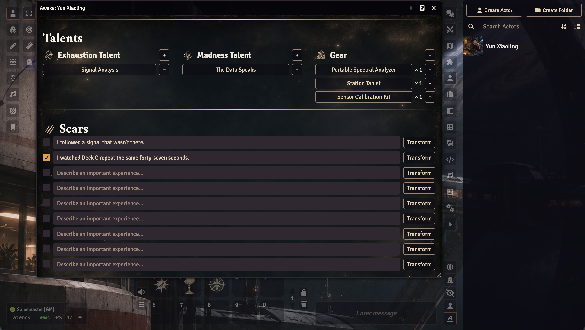
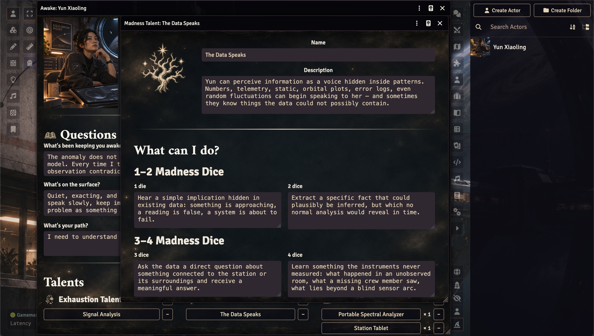
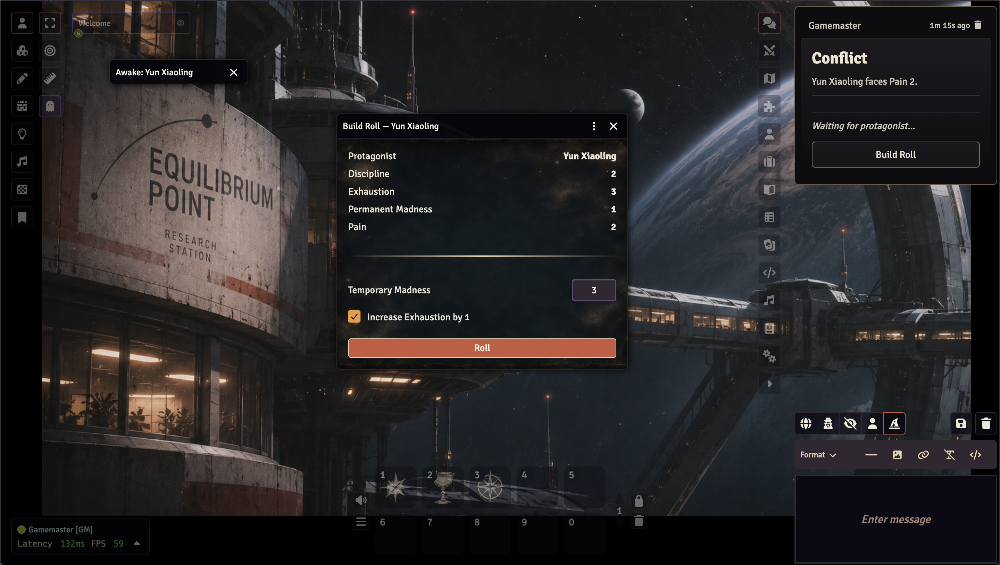
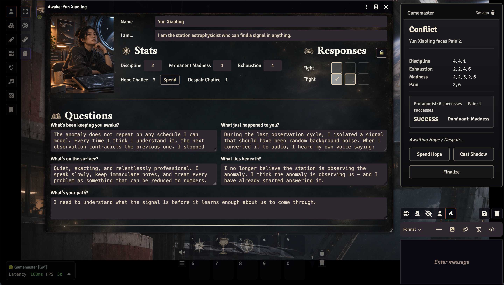

## What is Awake?

Awake is a custom game system for **Foundry Virtual Tabletop v14**.

It provides character management and automation for the main mechanics used during play, reducing manual bookkeeping while keeping the game itself at the table.

  

## Features

### Character Sheet

A dedicated character sheet includes:

- character identity and narrative Questions;
- Discipline, Exhaustion, and Permanent Madness;
- Fight and Flight Responses;
- Hope and Despair;
- Talents;
- Gear;
- Scars.

Character state is updated automatically when relevant mechanics are resolved.

  

### Talents

Exhaustion and Madness Talents are implemented as separate Foundry Items with dedicated sheets.

Madness Talents support multiple power levels, Fight and Flight effects, and character transformation fields.

  

### Conflict Resolution

The system supports the complete conflict workflow:

- starting a conflict and setting Pain;
- building the protagonist's dice pool;
- rolling Discipline, Exhaustion, Madness, and Pain;
- calculating success and dominance;
- spending Hope and Despair;
- finalizing the result;
- applying dominance consequences;
- applying additional consequences after failed conflicts.

  

  

### Consequences and Character State

Awake tracks and automates the mechanical effects of conflicts, including:

- Discipline recovery;
- Exhaustion increases;
- Fight and Flight Responses;
- Crash;
- Snap;
- temporary Recovery state;
- Permanent Madness.

  

### Shared Resources

Hope and Despair are stored as shared world resources and can be accessed from character sheets and conflict controls.

### Other Features

- Gear management
- Scar tracking
- Foundry permissions for GM and player actions
- Multiplayer support
- English localization
- Custom sheets, dialogs, and chat cards

## Technical Overview

Built with JavaScript for **Foundry VTT v14**, using custom Actor and Item data models, ApplicationV2 sheets, Handlebars templates, localization, and Foundry's multiplayer APIs.