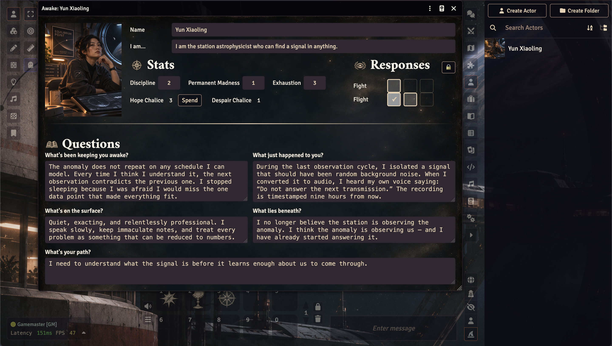
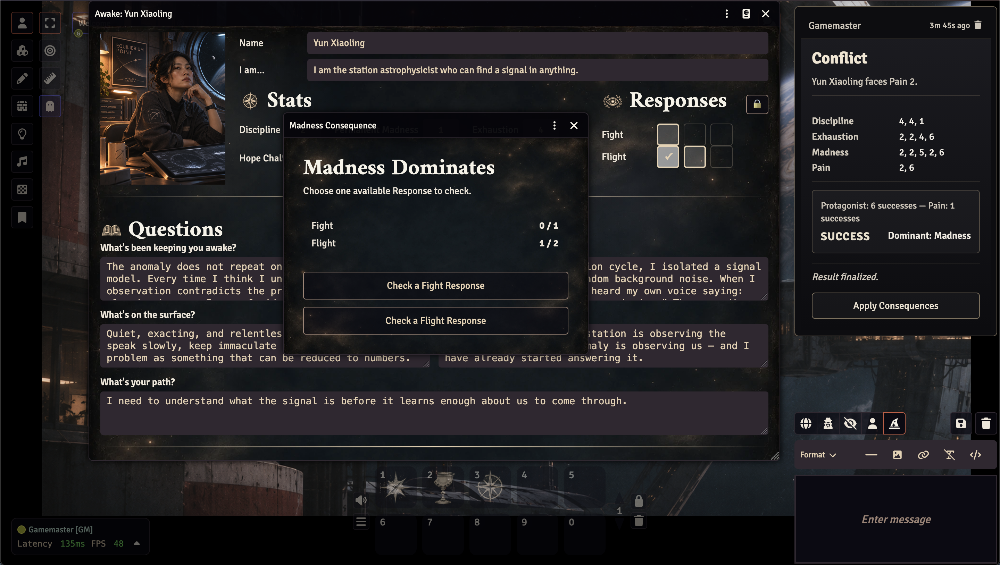

## What is Awake?

Awake is an unofficial, fan-made system for running *Don't Rest Your Head* in **Foundry Virtual Tabletop v14**.

It provides character management and automation for the game's core mechanics, reducing manual bookkeeping while leaving narration, Talent applicability, and GM rulings at the table.

A copy of the original *Don't Rest Your Head* rules is required to play.

  

## Features

### Character Sheet

A dedicated Awake character sheet includes:

- character identity and the five narrative Questions;
- Discipline, Exhaustion, and Permanent Madness;
- configurable Fight and Flight Responses;
- access to the shared Hope and Despair Chalices;
- Exhaustion and Madness Talents;
- Gear;
- Scars, including recalled and permanently transformed Scars.

Character state is updated automatically when relevant mechanics are resolved.

  

### Talents

Exhaustion and Madness Talents are implemented as separate Foundry Items with dedicated sheets.

Exhaustion Talent sheets support descriptions of Minor and Major Use. Madness Talent sheets support multiple power levels, Fight and Flight effects, and character transformation fields.

Players can select a Talent by name when building a conflict roll:

- **Minor Use** of an Exhaustion Talent sets a minimum number of successes based on the character's Exhaustion;
- **Major Use** increases Exhaustion by one and adds successes based on the resulting Exhaustion rating;
- **Madness Talent** use requires at least one temporary Madness die, with the required number determined by the GM.

Awake calculates the mechanical effects of Exhaustion Talents and accounts for them when recalculating conflict results. Temporary Madness dice can also be rolled without using a Talent. Talent use is unavailable during Crash recovery.

  

### Conflict Resolution

The system supports the conflict workflow from the initial roll to the application of consequences:

- starting a conflict and setting Pain;
- building the protagonist's dice pool, including optional temporary Madness and a voluntary Exhaustion increase;
- selecting a Talent and its mode of use;
- **Helping**, with one assisting protagonist per conflict contributing Discipline successes without affecting dominance;
- rolling Discipline, Exhaustion, Madness, and Pain;
- automatic success counting, Talent effects, and dominance resolution;
- modifying the result through Spend Hope, Cast Shadow, Recall Scar, or Transform Scar;
- recalculating success and dominance after dice pool modifications;
- finalizing the result;
- applying dominance consequences;
- applying optional additional consequences after failed conflicts.

  

  

### Consequences and Character State

Awake tracks and automates the mechanical effects of conflicts, including:

- reducing Exhaustion or clearing a Response when Discipline dominates;
- increasing Exhaustion when Exhaustion dominates;
- checking Fight or Flight Responses when Madness dominates;
- adding Despair when Pain dominates, subject to the Cast Shadow rules;
- optional failure consequences, with restrictions on duplicating dominance effects;
- individual consequences for the main protagonist and the assisting protagonist;
- **Crash** and the associated changes to character state;
- **Recovery**, including Talent restrictions and restoration after the required period of sleep and wakefulness;
- **Snap**, including loss of Discipline, gain of Permanent Madness, and resetting Responses;
- automatic creation of a Nightmare when a protagonist loses their final point of Discipline.

  

### Nightmares

Nightmares have a dedicated Actor sheet with a Pain rating and description. The GM can start a conflict directly from a Nightmare sheet using its Pain rating.

When a protagonist becomes a Nightmare through Snap, Awake creates a new Nightmare Actor with a Pain rating derived from the character's dice pool, preserving the original protagonist Actor.

### Shared Resources

Hope and Despair are stored as shared world resources and displayed in dedicated **Chalices**. The GM can adjust both resources directly.

**Spend Hope** supports:

- improving success by adding dice showing 1 to the main protagonist's Discipline pool;
- reducing Exhaustion;
- clearing Fight or Flight Responses;
- restoring Discipline and reducing Permanent Madness.

Through **Cast Shadow**, the GM can spend Despair to add or remove dice showing 6 in eligible pools, potentially changing dominance. Spent Despair becomes Hope after the conflict is finalized.

The system updates the Chalices and conflict results as applicable, with GM approval for player Hope expenditure.

### Scars of Experience

Scars allow protagonists to carry significant experiences forward between sessions.

- **Recall Scar** — reroll one of the character's eligible dice pools with GM approval.
- **Transform Scar** — permanently cross out a Scar to change a Talent or immediately spend the equivalent of up to five Hope without drawing from the shared Chalice.
- **Prevent Crash** — transform a Scar to reduce Exhaustion before an imminent Crash, including a Crash caused by a failure consequence.

Recalled Scars are marked as used for the current session. Transformed Scars remain part of the character's history but cannot be recalled or transformed again. Talent changes are managed manually in agreement with the GM.

### Session Management

The **End Session** macro allows the GM to close a session after players have had the opportunity to spend their remaining Hope.

It empties both Chalices and resets recalled Scars while preserving transformed Scars and other character state.

### Other Features

- Gear management through dedicated Foundry Items
- GM and player workflows with permission checks and GM approval dialogs
- Shared state and conflict updates across connected clients
- Dedicated system macros
- Optional **Dice So Nice** integration with distinct pool colors and bronze dice textures
- Custom artwork, icons, sheets, dialogs, and chat cards
- English localization

## Technical Overview

Built with JavaScript for **Foundry VTT v14**, using custom Actor and Item data models, ApplicationV2 sheets, Handlebars templates, localization, and Foundry's multiplayer APIs.

Dice So Nice is optional and is not required for conflict resolution.

## Development Status

Awake is **pre-release but playable**. The core gameplay mechanics, character progression, and session management are implemented. The system is currently undergoing regression and multiplayer testing in preparation for its first packaged public release.

The current implementation supports one assisting protagonist and one Talent per conflict roll. Screenshots illustrate the main interface; individual controls may differ from the current development version.

Found a bug? Please open an [issue](https://github.com/pharmakis/awake-dryh/issues).
